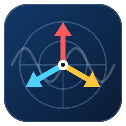
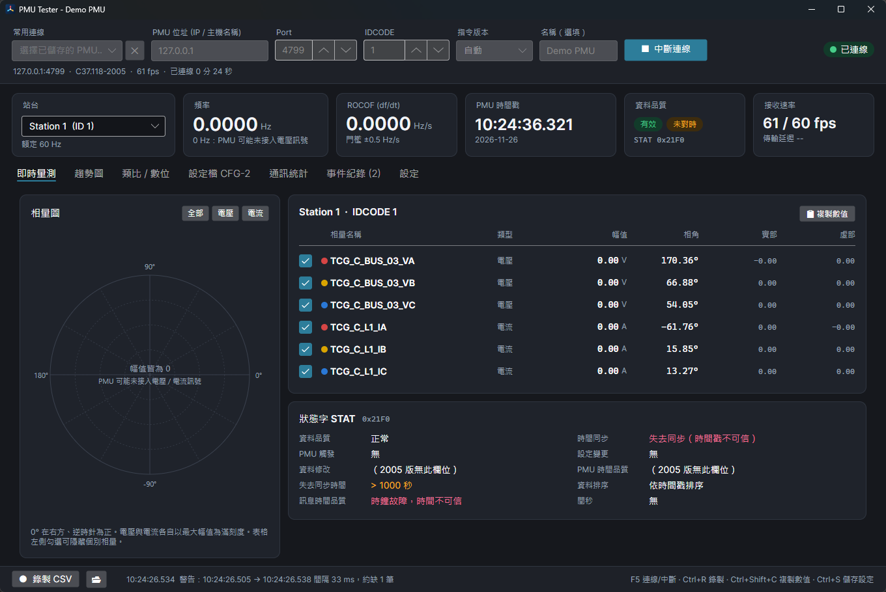
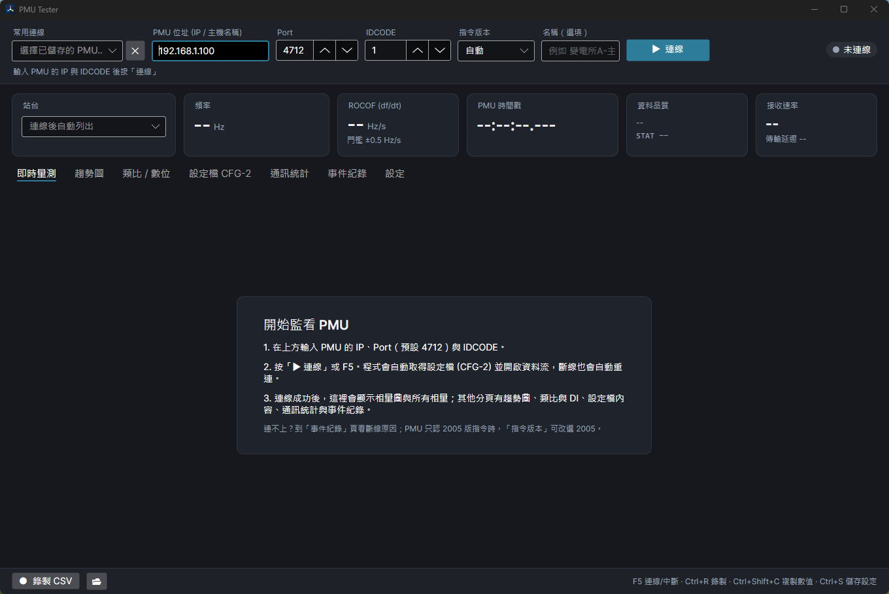
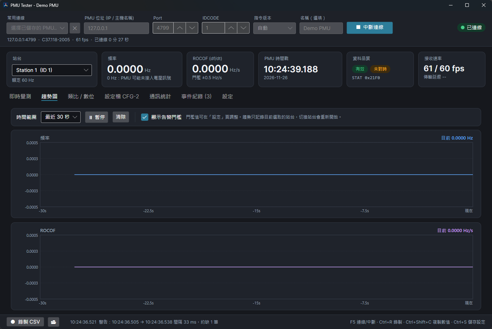
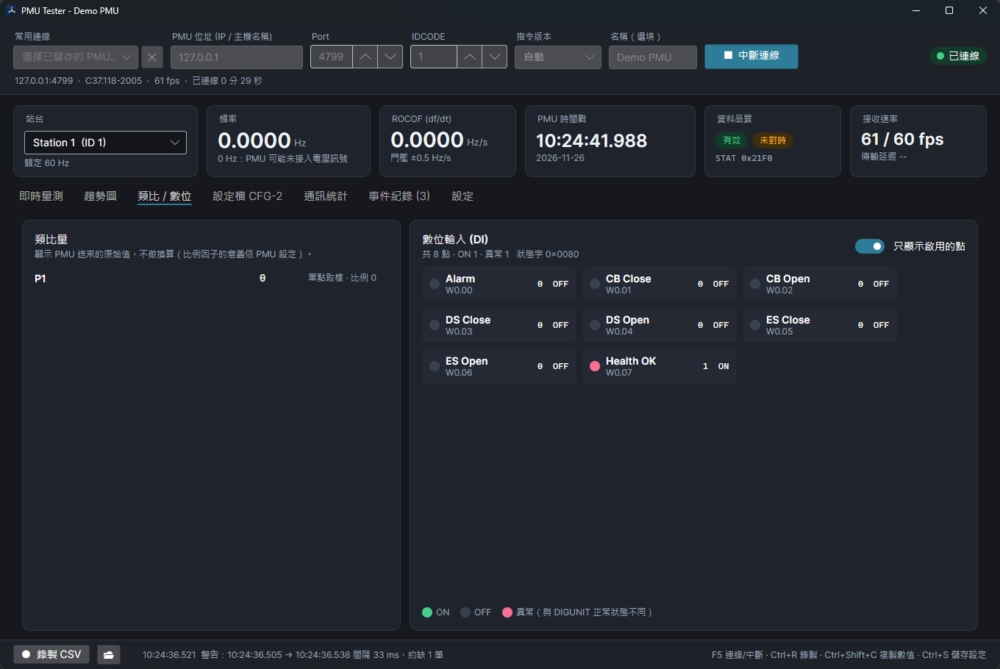
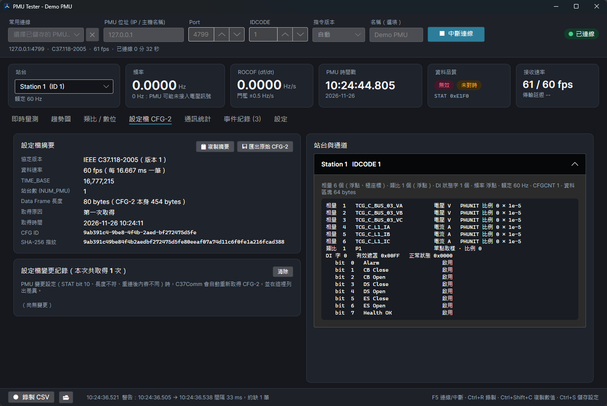
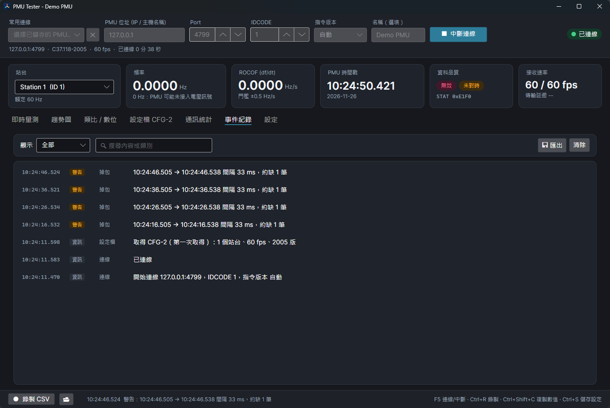

<p align="center">
  
</p>

<h1 align="center">PMU Tester</h1>

<p align="center">
  IEEE C37.118（2005／2011）同步相量量測裝置 (PMU) 即時監看桌面程式<br/>
  輸入 IP 與 IDCODE，按一下「連線」，就能看到頻率、ROCOF、相量圖、DI 與設定檔
</p>

<p align="center">
  
  
  
  
</p>



---

## 目錄

- [功能總覽](#功能總覽)
- [快速開始（5 分鐘上手）](#快速開始5-分鐘上手)
- [安裝與建置](#安裝與建置)
- [使用教學](#使用教學)
  - [1. 連線到 PMU](#1-連線到-pmu)
  - [2. 即時量測](#2-即時量測)
  - [3. 趨勢圖](#3-趨勢圖)
  - [4. 類比 / 數位](#4-類比--數位)
  - [5. 設定檔 CFG-2](#5-設定檔-cfg-2)
  - [6. 通訊統計](#6-通訊統計)
  - [7. 事件紀錄](#7-事件紀錄)
  - [8. 設定](#8-設定)
  - [CSV 錄製](#csv-錄製)
  - [告警](#告警)
- [鍵盤快捷鍵](#鍵盤快捷鍵)
- [設定檔 appsettings.json](#設定檔-appsettingsjson)
- [同時監看多台 PMU](#同時監看多台-pmu)
- [疑難排解](#疑難排解)
- [專案結構](#專案結構)
- [技術說明](#技術說明)
- [相關專案](#相關專案)

---

## 功能總覽

| 類別 | 功能 |
|---|---|
| **連線** | 輸入 IP／Port／IDCODE 即可連線；指令版本自動（2011 → 2005 自動切換）或固定；斷線自動重連並顯示倒數；成功連線的目標自動加入「常用連線」 |
| **即時量測** | 頻率（含相對額定值的偏差 mHz）、ROCOF、PMU 時間戳、資料有效性、對時狀態、實際接收 fps、傳輸延遲 |
| **相量** | 相量圖（三相自動配色、電壓實線／電流虛線、可個別隱藏）；相量表顯示幅值、相角、實部、虛部，極座標或直角座標都能換算 |
| **狀態字 STAT** | 逐項中文說明：資料品質、時間同步、PMU 觸發與原因、設定變更、資料修改、時間品質、閏秒等，依 2005／2011 版本解讀 |
| **多站台 (PDC)** | 站台下拉選單切換；多站台時另有所有站台總覽 |
| **趨勢圖** | 頻率與 ROCOF 即時曲線，10–600 秒時間範圍，顯示告警門檻線，可暫停 |
| **類比 / 數位** | 類比原始值與單位類型；DI 以燈號顯示 ON／OFF／異常 |
| **設定檔 CFG-2** | 協定版本、DATA_RATE、TIME_BASE、CFG ID、SHA-256 指紋、各站所有通道；PMU 變更設定時列出差異；可匯出原始 CFG-2 封包 |
| **通訊統計** | C37Comm 全部接收計數（CRC 錯誤、IDCODE 不符、處理太慢丟棄……）、掉包與時間倒退統計、最新封包 HEX |
| **告警** | ROCOF 連續 N 點超過門檻、頻率超出上下限；觸發與恢復寫入事件紀錄，數值卡片變紅 |
| **CSV 錄製** | 一鍵錄製，Excel 直接開啟不亂碼；可降頻、只錄有效資料；CFG-2 改變時自動換新檔 |
| **事件紀錄** | 連線、設定檔、掉包、告警事件；可篩選、搜尋、匯出 |
| **設定** | 所有參數都可在畫面上調整並儲存；淺色／深色主題 |

---

## 快速開始（5 分鐘上手）

> 需要 [.NET 10 SDK](https://dotnet.microsoft.com/download/dotnet/10.0)。

```bash
git clone https://github.com/denny90131/PmuTester.git
cd PmuTester
dotnet run
```

1. 程式開啟後，在上方輸入 **PMU 的 IP**、**Port**（一般是 `4712`）、**IDCODE**（要和 PMU 端設定的一樣）。
2. 按 **「▶ 連線」**（或按 `F5`、或在 IP 欄按 `Enter`）。
3. 右上角變成綠色 **「已連線」**，下方開始跳動數值，就成功了。



連不上的話，看[疑難排解](#疑難排解)。

---

## 安裝與建置

### 環境需求

| 項目 | 需求 |
|---|---|
| SDK | .NET 10 SDK（只要執行已發佈的版本可改裝 .NET 10 Desktop Runtime） |
| 作業系統 | Windows 10/11（主要測試平台）；Avalonia 也支援 Linux、macOS |
| 網路 | 能連到 PMU 的 C37.118 TCP Port（預設 4712） |

### 從原始碼建置

```bash
git clone https://github.com/denny90131/PmuTester.git
cd PmuTester
dotnet build -c Release
```

執行檔在 `bin/Release/net10.0/PmuApp.exe`。

> **C37Comm 套件從哪裡來？**
> PMU 通訊套件 `C37Comm.Client` / `C37Comm.Protocol` 不在 nuget.org，`.nupkg` 已放在 [`packages/`](packages/)，`nuget.config` 會自動從這裡還原，不需要額外設定。套件原始碼與版本紀錄在 [denny90131/C37Comm](https://github.com/denny90131/C37Comm)。

### 發佈成可攜式資料夾（給沒有安裝 .NET 的電腦）

```bash
# Windows x64，單一資料夾、內含 .NET Runtime
dotnet publish -c Release -r win-x64 --self-contained true -o publish/win-x64
```

把整個 `publish/win-x64` 資料夾複製到目標電腦，執行 `PmuApp.exe` 即可。`appsettings.json` 會一起放在資料夾內。

其他平台把 `-r` 換成 `linux-x64`、`osx-arm64` 等。

### 升級 C37Comm 套件

1. 從 [C37Comm Releases](https://github.com/denny90131/C37Comm/releases) 下載新版 `.nupkg` 放進 `packages/`。
2. 修改 `PmuApp.csproj` 中 `C37Comm.Client` 的版本號。
3. `dotnet restore && dotnet build`。

---

## 使用教學

### 1. 連線到 PMU

上方的連線列：

| 欄位 | 說明 |
|---|---|
| **常用連線** | 曾經成功連線的目標（最多 10 筆）。選一個就會自動填入下面各欄；按 `✕` 移除 |
| **PMU 位址** | PMU 或 PDC 的 IP、主機名稱 |
| **Port** | C37.118 TCP Port，一般是 `4712` |
| **IDCODE** | PMU 設定的 Stream IDCODE（0–65535），**必須和 PMU 一致**，不符會一直斷線 |
| **指令版本** | `自動`（建議）：先用 2011 版，PMU 沒回應時自動改用 2005 版。已知 PMU 只認 2005 版時選 `2005`，可省下約 3 秒切換時間 |
| **名稱** | 選填，顯示在視窗標題與常用連線清單，例如「變電所A-主PMU」 |

按 **「▶ 連線」** 後，程式會自動：

1. 建立 TCP 連線
2. 關閉 PMU 殘留的資料流
3. 請求設定檔 (CFG-2)
4. 開啟資料流

連線列下方會顯示目前狀態，例如：

- `127.0.0.1:4712 · C37.118-2005 · 60 fps · 已連線 2 分 13 秒`
- `連線逾時（3.0 秒） · 3 秒後自動重連`

右上角的膠囊顏色：🟢 已連線、🟡 連線中、🔴 已斷線、⚪ 未連線。斷線後程式會**自動重連**（1 → 1.5 → 2.25 → 3.4 → 5 秒，之後每 5 秒），不需要手動操作。

按 **「■ 中斷連線」** 會先送出「關閉資料流」給 PMU 再斷線；關閉視窗時也會做一樣的事。

### 2. 即時量測


**上方數值卡**（所有分頁都看得到）：

| 卡片 | 內容 |
|---|---|
| 站台 | 多站台 (PDC) 時切換要看的站台；下方顯示額定頻率 |
| 頻率 | 即時頻率，以及與額定頻率的偏差（mHz）。超出告警上下限時整張卡片變紅 |
| ROCOF | 頻率變化率 df/dt（Hz/s）與目前門檻。超過門檻時變紅 |
| PMU 時間戳 | Data Frame 的時間（可在設定改成 UTC） |
| 資料品質 | `有效／無效`（PMU 是否回報資料錯誤）、`已對時／未對時`（STAT bit 13）、STAT 原始值 |
| 接收速率 | 實際每秒收到的筆數 / CFG-2 設定的 DATA_RATE；傳輸延遲（收到時間 − PMU 時間戳，需雙方都對時） |

**相量圖**：0° 在右方、逆時針為正。電壓（實線）與電流（虛線）各自以最大幅值為滿刻度。顏色依名稱自動判斷相別（`VA`/`IA`/`_R` → 紅、`VB` → 黃、`VC` → 藍）。上方按鈕可切換「全部 / 只看電壓 / 只看電流」，相量表左側勾選框可隱藏個別相量。

**相量表**：名稱、電壓或電流、幅值（V/A）、相角（度或弧度）、實部、虛部。按 **「📋 複製數值」**（`Ctrl+Shift+C`）會把目前站台所有數值複製成 Tab 分隔文字，可直接貼到 Excel 或報告。

**狀態字 STAT**：把 16 個 bit 翻成中文，例如「失去同步（時間戳不可信）」「PMU 錯誤」「觸發中：df/dt 過高」。紅字代表會影響資料可用性，橘字代表需要注意。

### 3. 趨勢圖



- 上圖頻率、下圖 ROCOF，橫軸為最近 N 秒（10、30、60、120、300、600 秒可選）。
- 紅色虛線是告警門檻（頻率上下限、ROCOF ±門檻），可用「顯示告警門檻」開關。
- 「⏸ 暫停」只凍結畫面，資料仍在背景接收；「清除」重新開始。
- 趨勢只記錄**目前選取的站台**，切換站台會重新開始。
- 點數很多時每個像素取最大／最小值繪製，600 秒 × 60 fps 也不會卡。

### 4. 類比 / 數位



- **類比量**：PMU 送來的**原始值**（不換算），旁邊顯示 ANUNIT 類型（單點取樣／RMS／峰值）與比例因子。
- **數位輸入 (DI)**：每個點一個燈號。
  - 🟢 ON、⚪ OFF
  - 🔴 異常：值和 CFG-2 DIGUNIT 定義的「正常狀態」不同
  - 灰掉：DIGUNIT 有效遮罩中沒有啟用的點
- 右上角開關可切換「只顯示啟用的點」或「顯示全部 16 bit」。

### 5. 設定檔 CFG-2



- **設定檔摘要**：協定版本、資料速率、TIME_BASE、站台數、Data Frame 長度、取得原因、CFG ID（內容相同就是同一個 ID）、SHA-256 指紋。
- **站台與通道**：每個站台的資料格式、額定頻率、CFGCNT，以及所有相量（含 PHUNIT 比例）、類比、DI 名稱與遮罩。
- **設定檔變更紀錄**：PMU 改設定時（STAT bit 10、長度不符、重連後內容不同），程式會自動重新取得 CFG-2，並列出新增、移除、修改的項目。
- **📋 複製摘要**：整份設定檔說明複製成文字。
- **💾 匯出原始 CFG-2**：存成 `.bin`，可給廠商或用 `C37Comm.Protocol` 的 `Cfg2Parser` 離線分析。

### 6. 通訊統計


- **C37Comm 接收統計**：Data Frame、CFG-2 數量、重連次數、CRC 錯誤、IDCODE 不符、長度不符、處理太慢丟棄等。橘色代表有錯誤計數。「歸零」以目前數值為基準重新計算（不影響連線）。
- **資料完整性與告警**：連線時間、最後收到資料、實際接收速率、掉包事件與估計缺少筆數、時間倒退／重複、ROCOF 與頻率告警次數。
- **最新 Data Frame 原始碼**：十六進位傾印，含 SOC、FRACSEC、IDCODE、版本；「📋 複製 HEX」可貼給其他工具分析。

### 7. 事件紀錄



所有重要事件依時間由新到舊列出：

| 等級 | 例子 |
|---|---|
| 資訊 | 開始連線、已連線、取得 CFG-2、告警恢復、開始／停止錄製 |
| 警告 | 斷線（含原因與重連倒數）、掉包、時間倒退、PMU 變更設定 |
| 錯誤 | 啟動失敗、匯出失敗 |
| 告警 | ROCOF 連續 N 點超過門檻、頻率超出上下限 |

- 「顯示」可篩選：全部、警告以上、只看告警；搜尋框可找內容或類別。
- 不在此分頁時，分頁標題會顯示未讀的警告數，例如「事件紀錄 (3)」。
- 「💾 匯出」存成文字檔（Tab 分隔，可用 Excel 開）。最多保留 5000 筆。
- 畫面最下方的狀態列也會顯示最新一筆警告。

### 8. 設定

所有設定都可以在這頁修改，按 **「💾 儲存」**（`Ctrl+S`）寫入 `appsettings.json`。

| 區塊 | 內容 | 何時生效 |
|---|---|---|
| 畫面顯示 | 佈景主題（跟隨系統／淺色／深色）、相角單位、時區、時間戳格式、小數位數、更新週期、預設站台、視窗標題 | 立即 |
| 告警判斷 | 啟用、ROCOF 門檻與連續點數、頻率上下限、掉包偵測 | 立即 |
| CSV 錄製 | 資料夾、每 N 筆存一筆、只錄有效資料、加錄實部／虛部、UTC 或本機時間 | 下次開始錄製 |
| 連線進階參數 | 開啟程式後自動連線、TCP 連線逾時、無資料逾時、CFG-2 逾時與重送次數、重連等待時間與倍率、接收暫存上限 | 下次連線 |
| 診斷記錄檔 | 把 C37Comm 內部訊息寫入檔案（等級、資料夾、檔名、保留天數） | 下次連線 |

其他按鈕：**重新載入設定檔**（手動改檔後套用）、**還原預設值**（保留連線目標與常用連線）、**用記事本開啟設定檔**、**開啟程式資料夾**。

### CSV 錄製

1. 連線後按左下角 **「● 錄製 CSV」**（`Ctrl+R`）。
2. 狀態列顯示 `● 錄製中 01:23　4,980 筆　pmu_192.168.1.100_1_20261126_101404_339.csv`。
3. 再按一次停止；按 📂 開啟資料夾並選取檔案。

檔案格式（UTF-8 BOM，Excel 直接開啟不亂碼）：

```csv
Time(UTC),SOC,FRACSEC,FREQ(Hz),ROCOF(Hz/s),VALID,STAT,VA.MAG(V),VA.ANG(deg),...,P1,DIGITAL0
2026-11-26 02:14:04.329041,1795659244,5520407,59.998,0.012,1,0x0000,63508.2,-12.41,...,0,0x0080
```

- 每個 Frame 一列；多站台時欄位前加站台名稱（`STATION.FREQ(Hz)`）。
- 相量為幅值與相角（度），可選擇加錄實部／虛部；類比為原始值；DI 為狀態字（十六進位）。
- PMU 設定檔改變時自動換新檔，欄位與新設定一致。
- 寫檔在背景執行，不會拖慢接收；60 fps 約每分鐘 3,600 列。

### 告警

| 告警 | 觸發條件 | 恢復條件 |
|---|---|---|
| ROCOF | 連續 N 個**有效**點 \|ROCOF\| ≥ 門檻（預設 0.5 Hz/s、N = 3） | 有一點低於門檻 |
| 頻率 | 有效點的頻率 > 上限或 < 下限（預設 60.5 / 59.5 Hz） | 回到上下限之間 |
| 掉包 | 相鄰兩筆時間戳間隔 > 1.5 倍 DATA_RATE 間隔 | — |
| 時間倒退 | 時間戳沒有前進 | — |

- 無效點（PMU 回報資料錯誤或 ROCOF 缺值）不列入判斷，ROCOF 連續計數歸零。
- 頻率剛好 0 Hz 時視為「PMU 未接入電壓訊號」，不觸發頻率告警。
- 所有站台都會判斷；觸發與恢復都寫入事件紀錄，右上角顯示「⚠ 告警中 N 項」。
- 50 Hz 系統請到設定頁把上下限改成例如 50.5 / 49.5。

---

## 鍵盤快捷鍵

| 按鍵 | 功能 |
|---|---|
| `F5` | 連線 / 中斷連線 |
| `Enter`（在 IP 欄） | 連線 |
| `Ctrl+R` | 開始 / 停止 CSV 錄製 |
| `Ctrl+Shift+C` | 複製目前站台所有數值 |
| `Ctrl+S` | 儲存設定 |

---

## 設定檔 appsettings.json

設定檔放在執行檔旁邊，每個欄位都有中文註解。一般**不需要手動編輯**，在程式的「設定」頁調整即可。

```jsonc
{
  // ---- PMU 連線目標（上方連線列的內容，按「連線」時會自動儲存） ----
  "Connection": {
    "Host": "192.168.1.100",      // PMU / PDC 的 IP 或主機名稱
    "Port": 4712,                 // TCP 埠號（C37.118 慣用 4712）
    "IdCode": 1,                  // Stream IDCODE（0–65535），須與 PMU CFG-2 一致
    "CommandVersion": null,       // null = 自動；1 = 固定 2005；2 = 固定 2011
    "AutoConnect": false,         // true = 開啟程式後自動連線
    "Description": "變電所A-主PMU"
  },
  "SavedConnections": [ ... ],    // 常用連線（自動維護）
  "Timeouts":  { ... },           // 連線 / 無資料 / CFG-2 逾時
  "Reconnect": { ... },           // 自動重連間隔
  "Buffer":    { ... },           // 接收暫存上限
  "Ui":        { ... },           // 畫面顯示
  "Alarm":     { ... },           // 告警門檻
  "Recording": { ... },           // CSV 錄製
  "Logging":   { ... },           // 診斷記錄檔
  "Database":  { ... }            // 【預留】資料庫儲存，尚未實作
}
```

- 按「連線」或「儲存」時程式會改寫此檔，註解由程式自動重新產生。
- 手動修改後，在程式內按「重新載入設定檔」即可套用（需先中斷連線）。
- 檔案刪除後，下次啟動會以預設值重新建立。
- 建置時只有在輸出資料夾**還沒有** `appsettings.json` 時才會複製過去，不會覆蓋你在程式內存好的設定。

---

## 同時監看多台 PMU

每個視窗用不同的設定檔即可：

```bash
PmuApp.exe --config D:\pmu\substation-a.json
PmuApp.exe --config D:\pmu\substation-b.json
```

指定的檔案不存在時會自動建立。建議在每個設定檔填好 `Description`，視窗標題就會顯示「PMU Tester - 變電所A」，方便辨識。也可以搭配 `"AutoConnect": true` 做成開機自動監看的捷徑。

---

## 疑難排解

| 現象 | 可能原因與處理 |
|---|---|
| 一直「連線中 → 已斷線」，原因是「連線逾時」或「連線失敗」 | IP、Port 不對；防火牆擋住；PMU 的 C37.118 連線數已滿（其他 PDC 佔用）。先用 `ping`、`Test-NetConnection <IP> -Port 4712` 確認網路 |
| 連上後馬上斷線，診斷記錄有「設定的 IDCODE 與 PMU 不符」 | IDCODE 和 PMU 設定不同。到 PMU 的 C37.118 設定頁確認 |
| 斷線原因「CFG-2 請求逾時」 | PMU 沒回應設定檔請求。確認 PMU 端已啟用 C37.118 輸出；若固定了指令版本，改回「自動」試試 |
| 每次連線都要等約 3 秒才有資料 | PMU 只認 2005 版指令，程式在自動切換。把「指令版本」固定為 `2005` 即可 |
| 「未對時」一直亮、時間戳是很久以前 | PMU 沒有接 GPS / PTP。資料仍可使用，只是時間戳不可信 |
| 頻率、ROCOF、相量幅值都是 0 | PMU 沒有接入電壓 / 電流訊號 |
| 剛連上前幾秒顯示「無效」 | 部分 PMU（例如 Siemens 6MD85）剛開始送資料時 STAT 標示資料無效，屬正常現象 |
| 「處理太慢丟棄」持續增加 | 電腦太忙或畫面更新太頻繁。到設定頁把「畫面更新週期」調大（例如 100–200 ms） |
| 想看更詳細的連線過程 | 設定頁開啟「診斷記錄檔」，等級選 `Debug`，下次連線後按 📂 開啟記錄資料夾 |

---

## 專案結構

```
PmuTester/
├── PmuApp.csproj              專案檔（.NET 10、Avalonia 12、C37Comm.Client 1.1.1）
├── nuget.config               套件來源：packages/ + nuget.org
├── packages/                  C37Comm .nupkg（不在 nuget.org）
├── appsettings.json           預設設定檔（含中文註解）
├── Assets/pmu.ico             程式圖示
├── App.axaml                  主題配色（淺色 / 深色）與共用樣式
├── MainWindow.axaml(.cs)      主視窗版面；剪貼簿、存檔對話框、主題切換
├── MainViewModel.cs           連線管理、C37Comm 事件處理
├── MainViewModel.Live.cs      即時數值、相量、類比、DI、STAT 拆解
├── MainViewModel.Tools.cs     CFG-2、通訊統計、事件紀錄、CSV 錄製、設定頁
├── FrameMonitor.cs            掉包 / 時間倒退偵測、ROCOF 與頻率告警、fps 計算
├── CsvRecorder.cs             背景 CSV 寫檔
├── TrendBuffer.cs             趨勢圖環狀緩衝
├── Controls/
│   ├── PhasorDiagram.cs       相量圖控制項
│   └── TrendChart.cs          趨勢圖控制項
├── AppSettings.cs             設定檔模型、驗證、含註解的 JSON 輸出
├── FileLogger.cs              C37Comm 診斷記錄寫檔
└── docs/images/               README 截圖
```

---

## 技術說明

- **通訊**：[C37Comm.Client](https://github.com/denny90131/C37Comm) 負責 TCP 連線、自動重連、CFG-2 取得與變更偵測、封包切分、CRC、Data Frame 解析，並以事件送出資料。本程式只處理事件。
- **執行緒**：C37Comm 在專用執行緒上依序觸發事件。事件處理只做最快的工作（保存最新 Frame、寫入趨勢緩衝、告警判斷、放入錄製佇列）；畫面由 UI 計時器（預設 50 ms）讀取最新資料更新，檔案 I/O 在背景工作中進行，不會阻塞接收。
- **畫面更新**：只更新目前分頁需要的資料；趨勢圖與相量圖是自繪控制項，不依賴第三方圖表套件。
- **相量換算**：使用 Protocol 1.1.0 的 `ToMagnitude()`、`ToAngleDegrees()`、`ToReal()`、`ToImaginary()`，PMU 送極座標或直角座標都能正確顯示。
- **掉包判斷**：依 CFG-2 的 DATA_RATE 算出預期間隔，相鄰時間戳間隔 > 1.5 倍即判定掉包（參考 C37Comm Client 手冊 6.3）。
- **UI**：Avalonia 12 + Fluent 主題，MVVM 使用 CommunityToolkit.Mvvm。

---

## 相關專案

- [**C37Comm**](https://github.com/denny90131/C37Comm)：本程式使用的 IEEE C37.118 通訊套件（.NET 10），包含 Client、Protocol 與命令列試跑工具 Probe。
